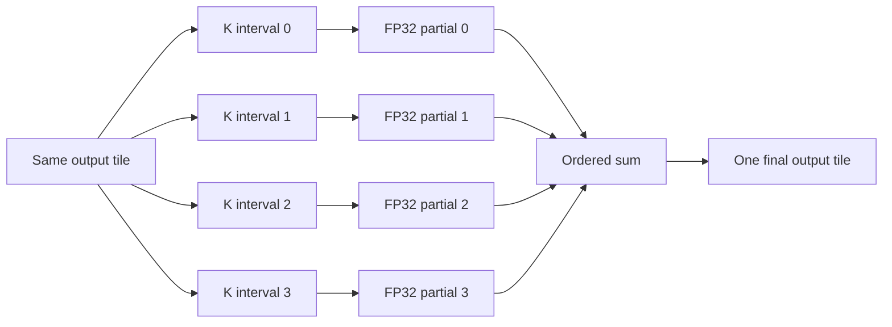

# Narrow GEMM on Hopper: finding parallelism before chasing peak FLOPS

Let's multiply a matrix with only 64 rows. The other dimensions are large, the
inputs are BF16, and the hardware is a Hopper H100/H200. This sounds like a smaller version
of a square Tensor Core GEMM. The first surprise is that a very respectable
square-GEMM design can expose only 16 independent output tiles.

We will build a kernel in numbered steps, explain what each step is meant to
fix, and keep a cuBLAS baseline throughout. The format is inspired by
[Outperforming cuBLAS on H100: a Worklog](https://cudaforfun.substack.com/p/outperforming-cublas-on-h100-a-worklog).
The objective here is to understand the decisions for a narrow shape. Whether
our implementation beats cuBLAS is an experiment to run, not a promised result.

For H200 MIG, read the [offline tuning follow-up](docs/H200_MIG.md): it records
user-reported starting and follow-up measurements. The
[source audit](docs/SOURCE_AUDIT.md) maps the additional mechanisms now
implemented in stages 9–14 to their exact upstream sources.
The full-chip H100 model below should not be scaled blindly to a MIG profile.

All numerical performance estimates below are **analytical models**. There are
no measured speedups in this document. The companion code was compile-checked;
the authoring environment has no GPU. See [the validation record](docs/VALIDATION.md).

## Setup: exactly what are we multiplying?

We use the convention **`(M,N,K) = (64,4096,8192)`**:

```text
A: [64,8192]   row-major       address A[m*K + k]
B: [8192,4096] column-major    address B[n*K + k]
C: [64,4096]   row-major       address C[m*N + n]

C[m,n] = sum_k float(A[m,k]) * float(B[k,n])
```

Both inputs are BF16. Accumulators, split-K partials and output are FP32.
`alpha=1`, `beta=0`; there is no bias, activation, transpose kernel or padding
kernel. B's physical storage can also be viewed as row-major `[N,K]`. This is
common when applying a stored linear-layer weight as `X @ W.T`. It is an input
contract, not a conversion hidden outside the timer. Starting with a different
layout requires a different kernel or accounting for the conversion cost.

Every dimension is aligned and every tile fits. The kernels omit edge masks on
purpose. See [README](README.md) for build and run commands.

We use H100 SXM's **132 SMs**, approximately **3.35 TB/s HBM bandwidth**, and
approximately **989 TFLOP/s dense BF16 Tensor Core peak** as a reference model.
Other H100 variants, clocks and power limits differ. The harness prints the
actual GPU and SM count. H100 supports up to 2,048 resident threads per SM;
the 1,024-thread limit is per block. A warp has 32 threads and a warpgroup has
128 threads. WGMMA is a warpgroup operation; our introductory `mma.sync` code
uses warp-level instructions instead. Every custom kernel is handwritten:
there are no CUTLASS/DeepGEMM calls or matrix/pipeline helper implementations.

## Before kernel 1: do the arithmetic

The useful work is

```text
2*M*N*K = 4,294,967,296 FLOPs = 4.295 GFLOPs.
```

Assuming each input is fetched from HBM once and C is written once:

| Tensor | Bytes | Size |
| --- | ---: | ---: |
| A | 1,048,576 | 1 MiB |
| B | 67,108,864 | 64 MiB |
| C | 1,048,576 | 1 MiB |
| Total | 69,206,016 | 66 MiB |

That is about **62.06 FLOP/byte**. Dividing 66 MiB by 3.35 TB/s gives a
**20.66 microsecond** ideal HBM-streaming time, or about **208 TFLOP/s** of useful
work. Dense Tensor Core peak divided by bandwidth is roughly 295 FLOP/byte, far
above our compulsory intensity. Under this traffic model, peak compute is the
wrong target.

This is a conditional roofline, not a universal lower bound on every benchmark.
HBM sees cache misses, while our formula assumes every input byte comes from
HBM. A is small enough for L2 reuse; B alone exceeds the nominal 50 MB L2 capacity
of an H100 SXM. Still, repeated launches can retain part of B and benefit from
other cache effects. You cannot infer cold HBM traffic from allocation sizes
alone. Measure the traffic before declaring a run bandwidth-bound.

Now count independent jobs. Give one CTA a `BM x BN` output tile. With `BM=64`,
there is just **one tile along M**:

| Tile | Output CTAs | CTAs / 132 SMs | Useful M rows |
| --- | ---: | ---: | ---: |
| 128 x 256 | 16 | 0.12 | 64 / 128 |
| 64 x 256 | 16 | 0.12 | 64 / 64 |
| 64 x 128 | 32 | 0.24 | 64 / 64 |
| 64 x 64 | 64 | 0.48 | 64 / 64 |
| 64 x 32 | 128 | 0.97 | 64 / 64 |

A `128 x 256` kernel also needs masking for the nonexistent rows. We do not
implement it. The table explains why copying that tile from a square-GEMM
worklog would be a poor starting point.

These ratios describe available CTAs, not hardware occupancy. Registers, shared
memory, block placement, multiple resident CTAs and issue behavior still matter.
But no occupancy tweak can schedule 64 distinct jobs on all 132 SMs at once.

## Kernel 0: establish a reference we can trust

[The baseline](include/reference.cuh) uses `cublasGemmEx`, BF16 inputs and FP32
output with FP32 computation. We disable reduced-precision intermediate
reductions. cuBLAS uses column-major matrices, so the call computes

```text
C^T = B^T * A^T
cublasGemmEx(OP_T, OP_N, N, M, K, ..., B, K, A, K, ..., C, N)
```

The `K` leading dimensions are intentional. A's row-major bytes already look
like column-major `A^T`. Check this mapping before tuning: the wrong reference
can make a transposition bug look correct.

The driver checks 32 cuBLAS entries against a CPU double-precision dot product
over the **already rounded BF16 inputs**. Every custom output is then compared
with cuBLAS, before and after timing. The acceptance rule is

```text
abs(actual - reference) <= 0.005 + 0.0005 * abs(reference)
```

It rejects nonfinite outputs and poisons output/partial buffers with NaNs before
the first validation. These tolerances accommodate accumulation order; they are
not a general numerical guarantee. Use the `ones` and `alternating` patterns as
additional structured checks, and do not loosen tolerances to hide failures.

`GemmEx` is a reproducible baseline, not an exhaustive cuBLASLt algorithm search.
Any public claim about outperforming the library should additionally compare
against tuned cuBLASLt with the same layouts, types, workspace allowance and
execution mode. In particular, FP32 output is a different workload from a BF16
output benchmark.

## Kernel 1: make the problem visible

Open [01_scalar.cuh](kernels/01_scalar.cuh). Each thread computes one C element
with 8,192 scalar FMAs. It has a long dependency chain, rereads operands and
does not use Tensor Cores. Adjacent threads vary N, so their B loads are also
separated by K elements in this layout. This is an intentionally elementary
starting point, not an optimized SIMT baseline.

```bash
../build/narrow_gemm --kernel 1 --iterations 1 --samples 3
```

This stage gives us a launch, an indexing equation and a correctness check to
preserve. We combine coalescing, reuse and Tensor Cores in the next stage; its
performance difference cannot be attributed to Tensor Cores alone.

## Kernel 2: reuse inputs and let Tensor Cores do the arithmetic

Open [02_mma.cuh](kernels/02_mma.cuh) and [tile.cuh](kernels/tile.cuh).
The current build starts with `BM=64`, `BN=64`, `BK=64`, and four warps per CTA.
`make -B WARP_BK=32` restores the original K tile; `WARP_BK=128` is another
compile-checked candidate. Larger BK amortizes outer-loop barriers but costs
shared memory and can lower residency:

1. Copy a `64 x BK` A tile and a `BK x BN` B tile into shared memory.
2. Synchronize the block.
3. Multiply them with raw warp-level `16 x 8 x 16` BF16 `mma.sync` instructions.
4. Synchronize before overwriting shared memory.
5. Advance K by BK. After all K chunks, store FP32 C.

Each warp owns **16 rows and all BN columns** of the output. A warp therefore
holds `BN/8` groups of four FP32 registers. The four warps cover 64 rows without
padding M. A single warp's A fragment is reused across its N fragments; shared
A is also reused across all BN columns and shared B across all 64 output rows.

```text
            N tile: BN columns
          +--------------------+
warp 0    | output rows  0..15  |
warp 1    | output rows 16..31  |
warp 2    | output rows 32..47  |
warp 3    | output rows 48..63  |
          +--------------------+
```

Copies move 16 bytes at a time: eight adjacent BF16 values along physical K.
Shared A is represented as `[64][BK+8]`, and shared B as `[BN][BK+8]`. The latter
is column-major when interpreted as the mathematical `BK x BN` matrix.
The extra eight elements preserve the required alignment and perturb bank
mapping. This simple padding is not a claim of conflict-free accesses and is
not the swizzled layout needed by our final Hopper stage.

There is no WMMA header. `ldmatrix.x4` loads the four 8x8 quadrants of A's
16x16 fragment into four packed registers per lane; `ldmatrix.x2` loads B's
16x8 column-major fragment into two. The instruction is written explicitly:

```text
mma.sync.aligned.m16n8k16.row.col.f32.bf16.bf16.f32
    {d0,d1,d2,d3}, {a0,a1,a2,a3}, {b0,b1}, {d0,d1,d2,d3}
```

For lane `l`, let `g=l/4` and `t=l%4`. Its four outputs are at
`(g,2*t)`, `(g,2*t+1)`, `(g+8,2*t)`, `(g+8,2*t+1)` inside a 16x8 tile.
Our stores apply this mapping directly. The 32 lanes cover all 128 outputs
exactly once. A load's lane addresses select each 8x8 quadrant; copying a
contiguous register slice and assuming it is a matrix fragment would be wrong.

### Experiment: smaller N tiles buy more jobs

```bash
../build/narrow_gemm --kernel 2 --bn 32
../build/narrow_gemm --kernel 2 --bn 64
../build/narrow_gemm --kernel 2 --bn 128
```

Shrinking BN increases the number of CTAs. It also increases repeated A
requests. Summed over all CTAs, A requests are

```text
(N/BN) * (2*M*K) bytes
BN=32: 128 MiB    BN=64: 64 MiB    BN=128: 32 MiB
```

B requests total 64 MiB in all three cases, ignoring cache-line effects. Those
A figures are **CTA-level requested bytes**, not HBM traffic: nearby CTAs can
reuse A through L2. For BN=64 the CTA-level input/output sum is 129 MiB, while
the compulsory HBM model was 66 MiB. Keeping those two levels separate is
essential when interpreting a roofline.

Larger BN also needs more output registers. MMA accumulators alone average
`BN/2` FP32 registers per thread: 16, 32 or 64 for this sweep. Operand fragments,
pointers and compiler temporaries add to that. Inspect ptxas output and local
memory traffic rather than assuming larger tiles always improve reuse enough
to win.

**What to measure:** runtime, active SMs, registers, spill loads/stores, Tensor
Core activity, shared-memory bank conflicts, and HBM/L2 bytes. If BN=32 wins
despite less A reuse, increased parallelism is a plausible explanation to test.

## Kernel 3: overlap tomorrow's loads with today's compute

Kernel 2 has a serial loop:

```text
load 0 -> compute 0 -> load 1 -> compute 1 -> load 2 -> compute 2
```

In [03_async.cuh](kernels/03_async.cuh), two buffers let us prefetch the next
chunk while Tensor Cores consume the current chunk:

```text
startup: copy tile 0, wait

iteration      0                  1                  2
copies         tile 1 -> buf 1    tile 2 -> buf 0    tile 3 -> buf 1
compute        tile 0 <- buf 0    tile 1 <- buf 1    tile 2 <- buf 0
end of step    wait + CTA sync    wait + CTA sync    wait + CTA sync
```

`cp.async` moves global memory directly to shared memory without staging every
value in a general-purpose register. It is available before Hopper and differs
from Hopper's multidimensional TMA engine. Here each thread issues its own
16-byte copies, commits a copy group, and waits for that group when necessary.

Two synchronization conditions matter:

- **Ready:** all issuing threads' copies must complete before any warp consumes
  the tile. A per-thread `wait_group` alone is insufficient for CTA cooperation.
- **Reusable:** every consuming warp must finish before the same buffer is
  overwritten two iterations later.

The block barrier at each iteration provides publication and protects reuse.
Our `mma.sync` sequence is synchronous from the warp's perspective, so
its operands have been consumed before that warp reaches the barrier. Later,
asynchronous WGMMA will require an additional completion rule.

```bash
../build/narrow_gemm --kernel 3 --bn 64
```

This is a modest two-buffer pipeline: one future group is outstanding, then
we drain it. It is intentionally easier to audit than a deeply staged queue.
Do not call it warp specialization; the same threads perform copies and math.
The SM still has only 64 output CTAs at BN=64.

**What to measure:** load-related stalls and runtime versus stage 2 at the same
BN. If there is little gain, the short supply of independent CTAs, copy issue
overhead, shared-memory behavior or bandwidth may dominate. The asymptotic
overlap model is `max(load_time, compute_time)`, with startup and drain costs.

## Kernel 4: split the reduction to expose more parallelism

We can reduce BN further, but it eventually gives very little work and reuse
per CTA. Another source of independence is the large K dimension.

Split K into S contiguous intervals. Compute

```text
P[s,m,n] = sum_{k=s*K/S}^{(s+1)*K/S-1} A[m,k] * B[k,n]
C[m,n]   = sum_{s=0}^{S-1} P[s,m,n]
```

[04_split_k.cuh](kernels/04_split_k.cuh) launches stage 3 with grid
`(N/BN, S)`. Grid Y selects the K interval. A second kernel reduces FP32 partials
in a fixed order. For S=1 we write C directly and skip the reduction.



With BN=64:

| S | CTAs | K per CTA | Waves assuming 1 CTA/SM | Filled slots in this model |
| ---: | ---: | ---: | ---: | ---: |
| 1 | 64 | 8192 | 1 | 48.5% |
| 2 | 128 | 4096 | 1 | 97.0% |
| 4 | 256 | 2048 | 2 | 97.0% |
| 8 | 512 | 1024 | 4 | 97.0% |

This is a scheduling model, not an occupancy prediction or a promise that S=2
wins. A second resident CTA may help latency hiding; extra waves may instead
just add work and overhead. BN=32 already has 128 CTAs before splitting.

### The bill for split-K

Each partial output is 1 MiB. Workspace is `S MiB`. Relative to direct output,
the algorithm requests `S MiB` of partial writes and `S MiB` of partial reads,
plus the unchanged final C write. For S=4 the extra requested traffic is
**8 MiB**, and workspace is **4 MiB**. Partials can stay in L2, so this is not
necessarily 8 MiB of extra HBM traffic.

We do **not** multiply the B traffic by S: each CTA reads only its own K
interval, and the intervals partition B. The total requested A bytes are also
unchanged at fixed BN; there are S times as many jobs but each reads 1/S of A's
K extent. Cache locality and transaction efficiency can still change.

There is also another kernel launch, repeated pipeline startup/drain, and a
shorter reduction chain per CTA. Bigger S eventually loses. The useful question
is where added parallelism stops compensating for those costs.

```bash
../build/narrow_gemm --kernel 4 --bn 64 --split 1
../build/narrow_gemm --kernel 4 --bn 64 --split 2
../build/narrow_gemm --kernel 4 --bn 64 --split 4
../build/narrow_gemm --kernel 4 --bn 64 --split 8
../build/narrow_gemm --kernel 4 --bn 64 --split 16
```

Always time both kernels together. The harness does so in both timing modes.
Do not report the partial-GEMM time alone as a complete GEMM result.

Why not `atomicAdd(C, partial)`? It needs initialization, introduces contention,
and changes summation order with scheduling. This small deterministic reduction
makes the experiment easier to validate. A fused one-kernel reduction needs a
carefully designed inter-CTA protocol; making every CTA spin for peers can
deadlock if those peers cannot be scheduled.

FP32 split-K still changes floating-point summation order. Apply nonlinear
epilogues, BF16 conversion, or an existing `beta*C` contribution **after** the
partials are combined. Applying an activation to each partial computes a
different function. Our workload has none of these epilogues.

**What to measure:** complete runtime, reduction time, number of active SMs,
partial-buffer traffic and the best S for each BN. Keep the smallest split that
earns its overhead. [scripts/model.py](scripts/model.py) prints this arithmetic
without requiring CUDA.

## Kernel 5: write TMA and WGMMA ourselves

Open [05_tma_wgmma.cuh](kernels/05_tma_wgmma.cuh),
[hopper_ptx.cuh](kernels/hopper_ptx.cuh), and [wgmma.cuh](kernels/wgmma.cuh).
The first Hopper checkpoint uses one 128-thread warpgroup and a **single**
shared-memory slot. Load a tile, wait, perform WGMMA, wait, reuse the slot.
This serial version makes the instruction and layout changes reviewable before
we add independent producer/consumer warpgroups.

We choose `BM=64`, `BK=64`, and retain `BN={32,64,128}`. Moving from stage 4 to
5 changes both the MMA instruction and the copy mechanism. Hopper BK stays
64 independently of the compile-time warp-MMA BK setting.
It is not an isolated measurement of any one instruction's benefit.

### Encode the input tensor maps

TMA can load a multidimensional tile without having every lane calculate and
issue its own copies. A CUDA driver call, `cuTensorMapEncodeTiled`, encodes the
hardware descriptor; it does not compute GEMM or implement a pipeline. Our
host helper supplies every field:

```text
                         A                      B
physical tensor dims     [K, M]                  [K, N]
physical byte strides    [2, 2*K]                [2, 2*K]
TMA box dims             [64, 64]                [64, BN]
element strides          [1, 1]                  [1, 1]
swizzle                  128 bytes              128 bytes
```

The descriptor API omits the implicit first stride, which is the element size.
We pass the descriptors by value using `__grid_constant__` kernel parameters,
so taking their addresses does not make per-thread local copies. Our elected
issuer uses raw PTX:

```text
cp.async.bulk.tensor.2d.shared::cluster.global.mbarrier::complete_tx::bytes
    [shared_destination], [tensor_map, {k_coordinate, row_coordinate}], [full]
```

For A the row coordinate is zero; for B it is `n_tile*BN`. Grid X enumerates
`job = slice*(N/BN) + n_tile`. The K coordinate is
`slice*(K/S) + k_step*64`. This implements split-K directly in our own launch
and address logic. The tensor maps always describe the original full matrices;
there is no repacking, interleaved-batch descriptor, or library batch scheduler.

### Match the WGMMA shared layout

The previous padded shared array is not a valid replacement for a WGMMA layout.
Both operands now use 128-byte TMA swizzling with K contiguous. For a logical
row `r` and BF16 position `k`, the byte offset is

```text
u = r*128 + 2*k
physical_byte_offset = u XOR (((u >> 7) & 7) << 4)
```

Every group of eight rows occupies 1024 bytes. This XOR permutes 16-byte chunks
inside a row, spreading accesses among bank groups. TMA performs the permutation
on load; WGMMA interprets the same swizzle on read. We do not independently
scramble the descriptor's K coordinate or perform a software transpose.

Every input stage starts at a 1024-byte boundary. In `wgmma_descriptor` we set:

| Descriptor bits | Value | Meaning |
| --- | --- | --- |
| 0..13 | shared address / 16 | Start of the 16-byte aligned operand slice |
| 16..29 | 16 / 16 | Leading byte offset field for this K-major layout |
| 32..45 | 1024 / 16 | Stride between groups of eight rows |
| 49..51 | 0 | Swizzle base offset, simplified by 1024-byte stage alignment |
| 62..63 | 1 | 128-byte swizzle layout |

We issue four K=16 instructions per BK=64 tile. Advancing the operand start
by 16 BF16 elements advances the descriptor's start address by 32 bytes. Keep
these constants tied to this exact K-major, BF16, 128-byte-swizzled layout.
Changing the layout requires rederiving the fields, not just changing a stride.

### The WGMMA register tuple is part of the implementation

The wrapper spells out the actual instruction and all output registers:

```text
wgmma.mma_async.sync.aligned.m64n64k16.f32.bf16.bf16
    {d0,...,d31}, descriptor_a, descriptor_b, use_previous_D, 1, 1, 0, 0
```

N=32 uses 16 registers per thread; N=64 uses 32; N=128 uses 64. The final two
zeros select K-major/non-transposed operands for this form. The input scales
are +1. The first instruction of each logical output tile sets scale-D to
false; subsequent instructions accumulate. The initial inline-assembly outputs
use `=f`, while accumulating instructions use `+f`. This defines the initial
register values without an explicit zero-fill or a C++ read of uninitialized
accumulators.

For consumer thread `tid`, define `warp=tid/32`, `lane=tid%32`,
`r=warp*16+lane/4`, and `c=j*8+2*(lane%4)`. Each group of four registers maps to
`(r,c)`, `(r,c+1)`, `(r+8,c)`, `(r+8,c+1)`. Looping j over BN/8 covers the
64xBN output exactly once across 128 threads. Stores use this equation directly.
No fragment or epilogue helper is called.

### Complete the transfers before reusing memory

One `full` mbarrier is initialized with arrival count one. The elected thread
uses `arrive.expect_tx` to declare **both** tiles' total byte count, then issues
both TMA loads against that barrier. All 128 consumers wait for its current
phase to complete. The transaction count reaching zero is part of completion;
issuing the loads alone is insufficient.

We then fence, issue four WGMMA operations, commit their group, and execute
`wgmma.wait_group 0`. Empty inline-assembly operand fences also expose the
register lifetimes to the compiler. A block barrier prevents the elected
thread from overwriting shared operands before every consumer has finished.
The full barrier's phase alternates each iteration. Initialization is published
with barrier-init/async-proxy fences before the first block synchronization.

```bash
../build/narrow_gemm --kernel 5 --bn 64 --split 1
../build/narrow_gemm --kernel 5 --bn 64 --split 4
```

The second command still includes the final FP32 reduction. Descriptor encoding
and launch attribute setup happen before timing. Read the entire stage: it is
short because we specialize one layout, not because a library hides the math.

## Kernel 6: use a producer warp and batch the completion rounds

Open [06_warp_specialized.cuh](kernels/06_warp_specialized.cuh). The tuned
version has **160 threads**: one 128-thread consumer warpgroup and a single
32-thread producer warp. Thread 128 issues TMA loads. A full 128-thread producer
warpgroup is unnecessary when one thread issues all transfers and the tile
does not need an asymmetric register budget.

Two parameters make the tradeoff explicit:

- `--stages 2|4` is the number of queue slots.
- `--batch-k 1|2` is the number of K=64 chunks in each slot.

With batch-K=2, four TMA instructions load two A boxes and two B boxes. One full
barrier tracks their **combined byte count**. The consumer issues eight WGMMA
instructions, commits one group, waits for it, and releases the slot. Each
chunk has its own 1024-byte-aligned base and the same 128-byte swizzle as stage
5. Enlarging the contiguous TMA box to 256 bytes instead would violate this
particular descriptor/swizzle contract.

The `SteadyWgmmaAccumulators` path clears FP32 registers before the K loop and
uses accumulating MMA instructions throughout the loop. It removes the branch
between overwrite and accumulation inside the async group. The original stage
5 retains that branch as the serial reference. In CUDA 12.6.85 compile checks,
the tuned path avoids the earlier serialization diagnostics. That establishes
a code-generation improvement, not a measured throughput gain.

### Four releases are enough

Each full barrier has arrival count one. Each empty barrier has count **four**:
after completing its WGMMA wait, lane zero of each consumer warp arrives once.
The original implementation made all 128 consumer threads arrive. Releasing a
slot still requires all consuming warps; it just avoids redundant lane arrivals.

For global chunk-group ordinal `tick`, let `slot=tick%Stages` and
`round=tick/Stages`:

```text
producer:
    if round > 0:
        wait for empty[slot] phase ((round-1) & 1) to complete
    full[slot].arrive_expect_tx(batch_k * (A_box_bytes + B_box_bytes))
    issue both input boxes for each K chunk

all 128 consumers:
    wait for full[slot] phase (round & 1) to complete
    issue the group's MMA instructions
    commit and wait_group 0
    lane zero of each warp arrives at empty[slot]
```

Initial slots are free, so their first empty waits are skipped. On reuse, the
producer waits for the previous generation's release; consumers wait for the
current generation's data. No CTA barrier belongs inside these independent
loops: it could make consumers wait for a producer that is itself waiting for
those consumers. Setup and final drain use block synchronization.

```bash
../build/narrow_gemm --kernel 6 --bn 64 --split 4 --stages 2 --batch-k 2
../build/narrow_gemm --kernel 6 --bn 64 --split 4 --stages 4 --batch-k 1
```

These two configurations have the same input capacity but different completion
frequency and queue granularity. Two slots with batch-K=1 cost less shared
memory and may allow more resident CTAs. The plan logs the real allocation and
CUDA's residency estimate before timing. Do not assume the deepest ring wins.

## Kernel 7: retain workers without starving a smaller GPU partition

Stage 7 uses the same producer/consumer code and a worker-stride job loop:

```text
job = blockIdx.x
while job < (N/BN)*S:
    n_tile = job % (N/BN)
    slice  = job / (N/BN)
    compute this tile's K/S interval and store its FP32 partial
    job += gridDim.x
```

The first implementation limited the grid to one worker per SM and requested a
128-register consumer budget. The user's H200 3g.71gb measurement found this
slower than the serial stage. Those settings are not retained as the defaults:
a narrow memory-bound kernel can need several independent CTAs per SM, and a
64x64 output has only 32 accumulator registers per consumer thread.

[07_persistent.cuh](kernels/07_persistent.cuh) now configures the kernel's real
shared-memory footprint, queries legal CTA residency, and caps the grid at
`visible_SM_count * resident_CTAs_per_SM`. The driver reports the MIG device's
visible SM count; no full-chip constant enters this launch policy. Normal
compiler register allocation replaces forced redistribution. The explicit
`setmaxnreg` wrappers remain available for separate resource experiments but
are not called by the tuned kernels.

`--workers-per-sm 0` selects the occupancy-based cap. `1`, `2`, and `4` request
smaller or larger caps, clamped to legal residency. This is still an unmeasured
policy, not a guarantee that maximal residency or persistence is fastest.

```bash
../build/narrow_gemm --kernel 7 --bn 64 --split 4 --workers-per-sm 0
../build/narrow_gemm --kernel 7 --bn 64 --split 4 --workers-per-sm 1
```

Producer and consumer `tick` counters continue across every job assigned to a
worker. Do not reset ring phases at output-tile boundaries. For split=32,
batch-K=2 there are only two chunk groups per job; a four-slot ring crosses job
boundaries midway through a ring traversal. Accumulation does reset: registers
are cleared before the next logical output tile, after the previous MMA wait.
The producer may prefetch that next job while consumers store the previous C.

## Kernel 8: can one warpgroup do the copying as well?

[08_cooperative.cuh](kernels/08_cooperative.cuh) tests a different answer to
producer overhead: use **128 threads total**. Thread zero issues future TMA
loads, then joins the rest of its warpgroup for WGMMA. TMA remains asynchronous;
a separate producer warp is not required for transfer/compute overlap.

The prologue loads up to `Stages-1` groups. At iteration t, thread zero issues
group `t+Stages-1` into a different slot before waiting for and consuming group
t. A final block barrier ensures all WGMMA reads of the current slot have
completed before the next iteration can refill it:

```text
two slots:
    prologue: issue group 0
    step 0: issue group 1; wait 0; MMA 0; wait MMA; CTA sync
    step 1: issue group 2; wait 1; MMA 1; wait MMA; CTA sync
    step 2: issue group 3; wait 2; MMA 2; wait MMA; CTA sync
```

There are no empty-slot barriers, dedicated producer threads, register
redistribution instructions or persistent job loop in this variant. It trades
independent producer progress for less control overhead and a smaller CTA.
It is particularly worth measuring when the serial TMA stage already beats
the more elaborate pipeline, as in the user's MIG result.

```bash
../build/narrow_gemm --kernel 8 --bn 64 --split 2 --stages 2 --batch-k 2
python3 scripts/sweep.py --profile h200-mig --kernels 5,8 --csv ../h200-first.csv
```

The profile supplies candidates, not measured winners. Keep the full-output
checks, include split-K reduction in the timer, and compare against the fresh
cuBLAS baseline in each row. The [H200 tuning notes](docs/H200_MIG.md) preserve
the original measurements and explain the reduced sweep.

## Kernel 9: reduce the work needed to describe and move a K slab

Stages 6–8 already combine two K64 atoms under one barrier. Their producer
still issues four input-copy instructions per K128 group. Can we issue two?

[The advanced engine](kernels/09_advanced.cuh), with raw instruction wrappers
in [advanced_ptx.cuh](kernels/advanced_ptx.cuh), changes the tensor map:

```text
logical input dimensions: [64, rows, K/64]
byte strides:              [2*K, 128]
copy box:                  [64, tile_rows, BatchK]
shared order:              [BatchK][tile_rows][64]
```

A coordinate `(k, row, atom)` still addresses the original element
`input[row*K + atom*64 + k]`. Global inputs require no transformation. With
`BatchK=2`, one 3D TMA instruction transfers both independently swizzled atoms
of A; another does the same for B. The full barrier expects their total bytes.
The swizzle box's contiguous dimension remains 128 bytes.

This stage also prefetches the tensor maps, constructs the descriptor high word
once per atom, uniformizes its low word with a warp shuffle, and increments the
start-address field for the four K16 MMA instructions. Each atom base remains
1024-byte aligned. These are concrete ideas from fast.cu's tensor maps and
DeepGEMM's descriptor setup; the [audit](docs/SOURCE_AUDIT.md) pins their sources.

The FP32 output mapping is unchanged mathematically, but adjacent values now
use explicit `st.global.v2.f32`. FP32 partials retain ordinary write-back
caching because the reduction reads them immediately. Importing a BF16
write-through store policy would require a separate traffic experiment.

Stage 9 keeps `wait_group 0` after every merged MMA group. It is a persistent
baseline for the next scheduling change, with the first MMA using scale-D=0
instead of explicitly clearing the accumulator tuple. Compare it with stage 7
using identical BN, split, batch and slot settings:

```bash
../build/narrow_gemm --kernel 9 --bn 64 --split 2 --stages 2 --batch-k 2
```

A faster copy issuer does not reduce B's unique byte count. If issue overhead
was already hidden, this bundle can produce little benefit. Inspect TMA issue
counts, descriptor instructions and end-to-end time before attributing a win.

## Kernel 10: keep an MMA group outstanding without releasing its operands

In stage 9, the consumer waits for every committed group before issuing the
next. CUTLASS's inspected SM90 mainloop keeps a group outstanding. The subtle
part is **which shared-memory buffer becomes reusable**.

Suppose groups 0 and 1 use slots 0 and 1. After committing both, `wait_group 1`
guarantees group 0 has finished. It says nothing sufficient to release slot 1.
We need separate read and release cursors:

```text
prologue:
    wait full[read]
    issue first MMA group with scale-D=0; commit
    read++
mainloop:
    wait full[read]
    issue accumulating group; commit
    wait until at most one committed group remains
    release empty[release] through the four consumer warps
    read++; release++
tail:
    wait until no group remains
    release the final operand slot
    store completed accumulators
```

[compute_advanced](kernels/09_advanced.cuh) implements this protocol. Every
read/release tick uses modulo `slots`, and generation parity derives from
integer division by `slots`. Ticks continue across persistent jobs; neither
tick nor phase resets at a tile boundary. A one-group segment takes only the
prologue and tail, which matters for Stream-K later.

The drain and overlap policies are separate compile-time variants. A runtime
branch choosing between wait 0 and wait 1 caused CUDA 12.6.85 to insert a
serialization dependency in an initial implementation. The final new paths
compile without that diagnostic. That is useful compiler evidence; GPU profiling
is still needed to assess how much overlap occurs.

```bash
../build/narrow_gemm --kernel 10 --bn 64 --split 2 --stages 2 --batch-k 2
../build/narrow_gemm --kernel 10 --bn 64 --split 2 --stages 6 --batch-k 2
```

Advanced stages accept BN=16/32/64/128/256 and slots=2/3/4/5/6/8. Every tile
still divides N. Two merged slots minimize storage; six merged slots test a
DeepGEMM-like depth. At BN=64/K128, six input slots occupy 197,632 bytes, versus
66,560 for two. Extra depth can hide latency while reducing resident CTAs.
Runtime resource checks skip combinations exceeding the visible device's
shared-memory budget. Queue depth remains an experiment, not a monotonic win.

## Kernel 11: put FP32 output on the asynchronous copy engine

After the final MMA drain, the accumulator is in registers. Stage 10 writes
it directly to global memory. DeepGEMM's FP32 path instead writes float2 pairs
to shared memory and lets TMA move the tile. Stage 11 implements that path;
there is no BF16 output conversion.

The output tensor map describes `[N, M*split]` FP32 elements. Slice `s`, tile
`t` is stored at `(t*BN, s*M)`. With split=1 the map targets C; otherwise it
targets the stacked partial array consumed by the existing reduction.

One shared output buffer belongs to the consumer WG. For each persistent job:

1. The elected store issuer waits for earlier TMA **shared reads** to finish.
2. A named barrier synchronizes the 128 consumers before any buffer overwrite.
3. Each consumer writes its aligned FP32 pairs to shared memory.
4. Writers fence to the async proxy, then synchronize their consumer group.
5. The elected thread issues the 2D TMA store and commits its bulk group.
6. The consumer proceeds to the next job's input/MMA work. Kernel exit waits
   for global completion of every outstanding store.

[store_advanced_tma](kernels/09_advanced.cuh) contains these steps. Waiting only
for shared reads before reuse permits global completion to overlap later work.
A whole-CTA barrier in the consumer loop would also wait for the independent
producer and could deadlock; the consumer uses its own named barrier.

```bash
../build/narrow_gemm --kernel 11 --bn 64 --split 2 --stages 6 --batch-k 2
```

At BN=64, output storage adds 16 KiB, making the six-slot allocation 214,016
bytes. That may change residency. Compare stage 11 with 10 at equal queue
settings and inspect occupancy as well as store efficiency. The reduction
remains timed. Faster partial stores do not remove partial reads or their launch.

## Kernel 12: distribute a stream of tile/K work and fix up only boundaries

Uniform split-K creates S partials for every output tile. Stream-K instead
partitions the flattened stream of `(N tile, K group)` work across a bounded
worker grid. Let `T=N/BN`, `G=K/(64*BatchK)`, `U=T*G` and `W=workers`:

```text
worker w owns units [floor(U*w/W), floor(U*(w+1)/W))
unit u belongs to tile floor(u/G), K group u%G
```

The iterator splits an interval at tile boundaries. A worker can own a suffix
of its first tile, whole middle tiles, and a prefix of its last tile. Whole
tiles write C directly; partial boundary tiles need fixup. At most two partial
tile slots are needed per worker. Several workers can still contribute to the
same tile when an interval is shorter than G.

Stage 12 uses the stage-10 input/MMA engine and implements the fixup itself in
[stream_k_store](kernels/09_advanced.cuh):

1. Each consumer writes its portion of the FP32 partial tile. Every writer
   executes a device thread fence, then all 128 consumers synchronize.
2. The elected thread performs an acquire/release atomic increment of that
   tile's counter. Iterator boundaries determine the expected contributor count.
3. Earlier arrivals move on. The last arrival broadcasts its decision to its
   consumer group, loads all contributors in **fixed worker order**, sums in
   FP32 and writes final C. Loads bypass L1 to avoid stale prior-replay partials.
4. After the group's final stores, the elected thread resets the counter.
   A complete invocation leaves all counters at zero for the next graph replay.

There is no CTA spinning on a different CTA's progress. This avoids requiring
all workers to be simultaneously resident. The host plan owns the counters and
two partial slots per worker, initializes them before timing, and captures the
same workspace for sequential use on its stream. Concurrent invocations must
use distinct plans/workspaces. This is a specialized Stream-K decomposition
and last-arrival protocol, rather than a copy of CUTLASS's full scheduler.

```bash
../build/narrow_gemm --kernel 12 --bn 64 --split 2 --stages 3 --batch-k 2
```

For **stage 12 only**, `--split` is a worker-budget multiplier:
`W=min(T*split, SMs*resident_cap)`. It does not impose S equal K slices per tile.
The table marks this decomposition as `stream-k`; all other partial paths say
`uniform`. Every counter operation and fixup is inside the timed kernel, with
no standalone reduction launch or per-replay memset.

If W divides T and ownership aligns with tile boundaries, fixup can disappear.
If W is much larger than T, most tiles can still have multiple contributors.
Two slots per worker can allocate more workspace than uniform split-K even
when requested partial traffic is lower. Measure traffic, wave tails and time;
Stream-K provides a different tradeoff, not a guaranteed reduction in each cost.

## Kernel 13: multicast A to neighboring N tiles

Our output has one M tile, so B has no neighboring M tile to share with. It has
many N tiles that use the same A. A two-CTA cluster along N can multicast A.

At BN=64, A has 1 MiB of unique data but 64 MiB of summed tile requests across
the N dimension. [multicast_gemm](kernels/13_multicast.cuh) pairs adjacent N
tiles. Each CTA loads its own B, while cluster rank zero issues one 3D A copy
with multicast mask `0b11`. This halves A copy requests per pair; it leaves
B's 64 MiB of unique data untouched. Actual HBM/L2 byte savings need profiling.

Two additional lifetime rules make the cluster work:

- Both full barriers must expect A+B bytes **before** the multicast. Each
  producer arms its barrier and signals rank zero's per-slot two-arrival
  handshake. Only after both arrive may rank zero multicast A.
- Both CTAs must finish reading A **before either producer reuses the slot**.
  Each of the four consumer warp leaders signals both replicas' empty barrier.
  Each empty generation therefore requires eight arrivals. The producer drains
  the last used generation of every slot; a final cluster barrier protects the
  remote shared-memory lifetime before either CTA exits.

Adjacent CTAs keep the same K interval and advance in an even grid stride, so
their A coordinates and barrier generations stay matched. The host queries
cluster support and active-cluster occupancy on the actual MIG device and
launches a legal paired grid. Unavailable configurations report `SKIP`.

```bash
../build/narrow_gemm --kernel 13 --bn 64 --split 2 --stages 3 --batch-k 2
```

Compare with stage 10. Placement restrictions, additional barrier traffic and
cluster startup can exceed the savings when A is already cheap to fetch. This
stage makes that a measurable hypothesis rather than declaring multicast
irrelevant just because M is narrow.

## Kernel 14: let a second consumer compute during the first one's epilogue

The previous stages have one consumer WG. An asynchronous output copy helps,
but arranging its shared tile still costs consumer instructions. CUTLASS's
ping-pong schedule suggests alternating **whole output jobs** between two WGs.

[pingpong_gemm](kernels/14_pingpong.cuh) uses 384 threads:

```text
threads   0..127: consumer WG 0, jobs 2*block + 0, then stride 2*grid
threads 128..255: consumer WG 1, jobs 2*block + 1, then stride 2*grid
threads 256..383: producer WG, one elected TMA issuer
```

Each consumer owns an input ring, accumulator tuple, named barrier and shared
output buffer. A math token starts with WG0. After draining its tile's MMA,
WG0 passes the token to WG1 and runs its FP32 shared/TMA epilogue. WG1 can now
compute; after its drain it passes the token back. Neither WG computes padded
rows or duplicates another WG's output. The producer fairly probes both rings
with nonblocking barrier tests, so one occupied ring cannot prevent progress
for its peer.

This full producer WG can legally redistribute registers: all 128 producer
threads release to 40 registers; each consumer WG requests 128, or 192 for
BN=256. Launch setup reserves over half the per-SM shared capacity, enforcing
one resident CTA and preserving enough register pool for the increases. The
same collective would not be legal if inserted only in the 32-thread producer
of stages 6–13.

```bash
../build/narrow_gemm --kernel 14 --bn 64 --split 2 --stages 2 --batch-k 1
```

Duplicated input/output storage and 384 threads are substantial costs. K64
atoms are a useful starting point; large BN/K128/depth combinations are skipped
when they exceed shared capacity. The one-CTA policy may lose memory latency
hiding even when math/epilogue overlap improves. Compare with stage 11 using
its own legal resource configurations, then use the advanced sweep to search.

## Workload boundaries

The additional mechanisms above fit the same BF16-input/FP32-output problem.
Some upstream features serve a different workload:

### L2 swizzling and Hilbert curves have less room here

There is one row of M tiles, not a large two-dimensional output grid. A Hilbert
traversal cannot extract the same two-axis operand reuse as in a square GEMM.
With split-K there is a new ordering question: do we schedule adjacent N tiles
with the same K interval close together to reuse A, or spread K partitions?
It is worth investigating only after profiling shows L2/request traffic is a
limiting factor. Block enumeration does not guarantee a particular SM mapping.

### FP8 changes the experiment

FP8 can cut B storage from 64 MiB to 32 MiB, changing both bandwidth demand and
whether weights can fit in L2. It also introduces scales, quantization cost and
a different accuracy target. Comparing it directly with our BF16 cuBLAS call
would conflate arithmetic formats. If exploring DeepGEMM's FP8 path, create a
separate benchmark including the scale layout and quantization boundary. We
keep BF16 throughout this tutorial, so another problem size is unnecessary.

### Output fusion is real, but its scope matters

Bias or activation fusion can avoid an additional launch and output pass. Our
output is only 1 MiB, while B is 64 MiB, so its importance depends on launch
latency and cache behavior rather than output size alone. For split-K, put such
an epilogue in the final reduction. Do not compare a fused implementation with
an unfused library result while omitting the library's extra work from timing.

## Measure a worklog, not a collection of anecdotes

Use [scripts/sweep.py](scripts/sweep.py), or run the commands manually. The
first pass should answer a small sequence of questions:

| Comparison | Question | Useful evidence |
| --- | --- | --- |
| Scalar vs warp MMA | Did the instruction/dataflow change pay off? | Runtime, MMA instructions, memory efficiency |
| BN=128 vs 64 vs 32 | Is reuse or parallelism more valuable? | Active SMs, requested bytes, register spills |
| Stage 2 vs 3, same BN | Does overlap hide a bottleneck? | Stall reasons, runtime, shared behavior |
| S=1 vs 2 vs 4 vs 8 | Does more K parallelism pay for reduction? | Full runtime and reduction breakdown |
| Stage 4 vs 5 | Does raw TMA/WGMMA help overall? | Same types, BN and S; full runtime |
| Stage 5 vs 6 | Does a specialized producer and input ring help? | Load stalls, shared footprint, complete runtime |
| Stage 6 vs 7 | Does persistence with enough workers help? | Visible SMs, legal residency and worker cap |
| Stage 5 vs 8 | Is cooperative prefetch cheaper than a producer? | Same BN/split, input capacity and complete runtime |
| Slots 2 vs 4; batch-K 1 vs 2 | Is buffering or fewer completion rounds more valuable? | Shared footprint, stalls, complete runtime |

The driver records median and minimum of multiple batch-average timings.
`TFLOP/s = 4294.967296 / time_us`. A speedup above one means faster than that
process's cuBLAS baseline. Median is the primary comparison; do not cherry-pick
minimum samples or compare graph replay with ordinary launches.

Both timing modes use CUDA events on the execution stream. Graph mode captures
`iterations` complete invocations, warms the graph, and measures replays.
Events mode submits the same number of invocations from the host between
events; CPU launch gaps can enter stream elapsed time for short kernels. That
difference is meaningful for an application but must be labeled.

The workload repeatedly uses the same addresses. A true cold-cache experiment
needs explicit cache disturbance outside each timed interval, fresh working
sets or application traces, followed by verification of actual HBM bytes.
Timing a cache-flush kernel inside the GEMM interval measures a different
operation. Timing only the partial GEMM omits required work. Neither is done by
the supplied harness.

Record GPU SKU, SM count, toolkit/cuBLAS version, driver, clocks/power/MIG state,
input distribution, warmup, repetitions, graph mode and cache policy with every
published result. The harness prints device/runtime metadata; use `nvcc
--version`, the installed cuBLAS package version (or `cublasGetVersion`), and
your machine's GPU tools for the remaining details.

For an initial profiler pass, shorten the run:

```bash
ncu --set full --target-processes all --export ../split4 \
  ../build/narrow_gemm --kernel 4 --bn 64 --split 4 \
  --timing events --iterations 1 --samples 1 --warmup 1
```

The report includes reference and validation launches too. Select the named
`async_gemm` and `reduce_split_k` launches when interpreting it. Nsight Compute
replay changes timing/cache state; use the separate unprofiled benchmark for
performance claims. Inspect Compute Workload Analysis, Memory Workload Analysis,
Launch Statistics, Occupancy and Scheduler Statistics; query the profiler for
metric names supported by your version. Tensor utilization alone cannot
distinguish bandwidth limits, long stalls and too few active SMs.

Fill in your measured table rather than copying numbers from another GPU:

| Stage | BN | S | Complete median, us | TFLOP/s | Speedup vs cuBLAS |
| --- | ---: | ---: | ---: | ---: | ---: |
| cuBLAS | — | 1 | unmeasured | unmeasured | 1.0 |
| Warp MMA | 64 | 1 | unmeasured | unmeasured | unmeasured |
| Async warp MMA | 64 | 1 | unmeasured | unmeasured | unmeasured |
| Split-K warp MMA | 64 | 2/4/8 | unmeasured | unmeasured | unmeasured |
| Serial TMA/WGMMA | 64 | best measured S | unmeasured | unmeasured | unmeasured |
| Specialized ring | 64 | best measured S | unmeasured | unmeasured | unmeasured |
| Persistent worker grid | 64 | best measured S | unmeasured | unmeasured | unmeasured |
| Cooperative TMA | 64 | best measured S | unmeasured | unmeasured | unmeasured |

For this one shape, a defensible tuning order is: preserve the indexing and
numerics, get Tensor Cores working, select a tile with enough useful work,
overlap memory movement, expose missing parallelism with K, then tune the
Hopper pipeline. Keep each change only when the complete operation improves.
